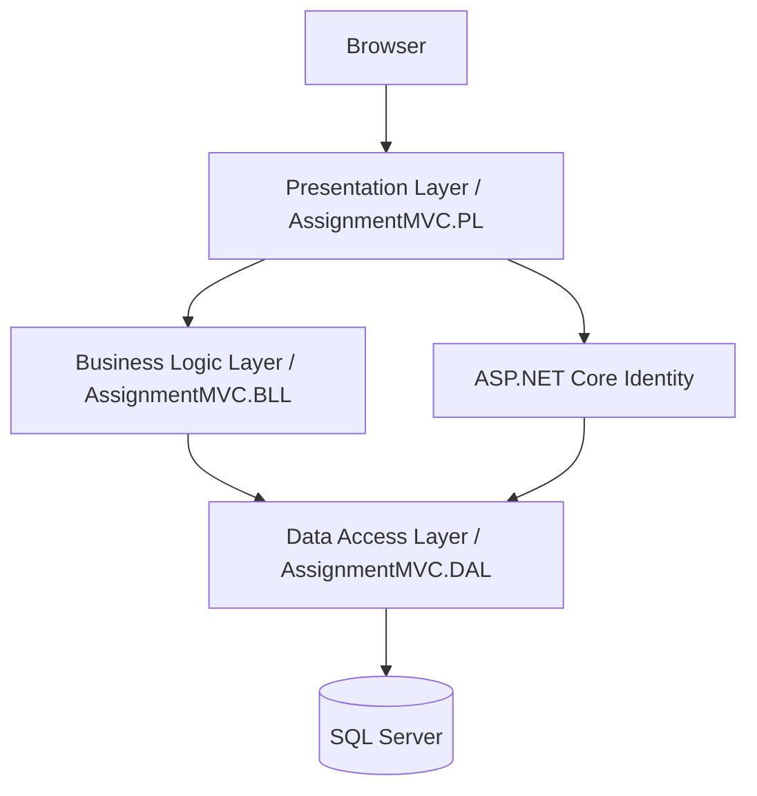

<div align="center">

# Management System | ASP.NET Core MVC

**A layered .NET 8 web application for managing organizational data with ASP.NET Core MVC, Entity Framework Core, and ASP.NET Core Identity.**


[Architecture](#-architecture) · [Tech Stack](#-technology-stack) · [Getting Started](#-getting-started) · [Project Structure](#-project-structure)

</div>

---

## 📖 Overview

**Management System MVC** is an ASP.NET Core MVC application organized into three projects to separate HTTP/UI concerns, application services, and data access. Its codebase includes employee and department modules, account/identity infrastructure, file-attachment services, and database-backed persistence.

This project demonstrates practical backend fundamentals such as **dependency injection**, **service/repository abstractions**, **Entity Framework Core**, **ASP.NET Core Identity**, **AutoMapper**, and the **Unit of Work pattern**.

> **Project scope:** The modules and implementation components described here were identified from the repository's solution, project references, and application startup configuration. This document intentionally avoids claiming unverified behaviors such as a specific role-permission matrix, advanced reporting, or complete workflows.

## ✨ Application Components

| Area | What the codebase provides |
| --- | --- |
| **Employee module** | Employee repository and service abstractions with registered implementations |
| **Department module** | Department repository and service abstractions with registered implementations |
| **Accounts & identity** | ASP.NET Core Identity configured with `ApplicationUser`, `IdentityRole`, and EF Core stores |
| **File attachments** | A dedicated attachment-service abstraction and implementation |
| **Data access** | SQL Server-backed EF Core `AppDbContext`, including lazy-loading proxies |
| **Object mapping** | AutoMapper mapping profile registered through dependency injection |
| **Data orchestration** | Unit of Work abstraction and implementation |
| **Web interface** | ASP.NET Core MVC controllers and views, with static-file support |

## 🧰 Technology Stack

| Category | Technology |
| --- | --- |
| Language | C# |
| Runtime / web framework | .NET 8, ASP.NET Core MVC |
| Persistence | Entity Framework Core 8, SQL Server |
| Authentication infrastructure | ASP.NET Core Identity |
| Mapping | AutoMapper |
| Design / organization | Three-layer architecture, Repository pattern, Unit of Work, dependency injection |
| Development tooling | Visual Studio or .NET CLI, EF Core tooling |

## 🏗️ Architecture

The solution is organized into a **three-layer structure**:



**Presentation Layer (`AssignmentMVC.PL`)**
- ASP.NET Core MVC application, controllers, views, and static assets
- Application bootstrapping, middleware, and service registrations
- Dependency references to the business logic layer

**Business Logic Layer (`AssignmentMVC.BLL`)**
- Employee and department service implementations and contracts
- Attachment-service functionality
- AutoMapper profile
- Dependency reference to the data access layer

**Data Access Layer (`AssignmentMVC.DAL`)**
- Entity Framework Core and SQL Server integration
- Application models, database context, and repository infrastructure
- ASP.NET Core Identity EF Core integration

## 📁 Project Structure

```text
Management-system-MVC/
├── AssignmentMVC.PL/       # ASP.NET Core MVC presentation project
├── AssignmentMVC.BLL/      # Business services and mappings
├── AssignmentMVC.DAL/      # Data access, models and repositories
├── MVC04.sln               # Visual Studio solution
├── .gitignore
└── .gitattributes
```

## 🚀 Getting Started

### Prerequisites

- **.NET 8 SDK**
- **SQL Server** (local SQL Server, Express, or another accessible SQL Server instance)
- Optional: **Visual Studio 2022** with ASP.NET and web development tools
- EF Core CLI tools if you need to apply migrations manually

### 1. Clone the repository

```bash
git clone https://github.com/omaresamaboamar/Management-system-MVC.git
cd Management-system-MVC
```

### 2. Restore dependencies

```bash
dotnet restore MVC04.sln
```

### 3. Configure the SQL Server connection

The application reads its database connection from **`ConnectionStrings:Defaultconnection`** (including that exact capitalization/spelling). For local development, use .NET User Secrets rather than committing credentials.

```bash
cd AssignmentMVC.PL
dotnet user-secrets init
dotnet user-secrets set "ConnectionStrings:Defaultconnection" "Server=.;Database=ManagementSystemDb;Trusted_Connection=True;TrustServerCertificate=True;"
cd ..
```

> Replace the server and authentication settings for your environment. Never commit a production connection string, password, or API key.

### 4. Prepare the database

If the repository contains EF Core migrations, make sure the EF Core CLI is installed, then apply them using the appropriate project/startup-project combination:

```bash
dotnet ef database update --project AssignmentMVC.DAL --startup-project AssignmentMVC.PL
```

> If the migrations live in a different project, change `--project` accordingly. If no migrations are committed, the database schema must be created or the migrations generated before running the app. The exact migration layout has not been verified here.

### 5. Run the application

```bash
dotnet run --project AssignmentMVC.PL
```

Open the HTTPS or HTTP URL printed in your terminal. The startup configuration currently maps its default route to `Account/Register`.

## 🔐 Identity & Security Notes

The startup code registers **ASP.NET Core Identity** with `ApplicationUser`, `IdentityRole`, Entity Framework stores, and default token providers.

Before deploying publicly:

- Keep connection-string credentials and all secrets outside source control.
- Review which endpoints require authentication and authorization.
- **Check the middleware order:** The current `Program.cs` calls `UseAuthorization()` before `UseAuthentication()`. Normally, `UseAuthentication()` should precede `UseAuthorization()`.
- Use HTTPS and production-appropriate error handling.

## 🧩 Engineering Highlights

- Separation of presentation, service, and persistence concerns
- Interface-driven dependency injection for employee and department services
- Repository abstractions with a Unit of Work service
- Entity Framework Core configured for SQL Server and lazy-loading proxies
- AutoMapper for mapping between application models
- Dedicated attachment-service abstraction
- ASP.NET Core Identity integration

## 🛣️ Potential Improvements

The following are **suggestions**, not claims about existing functionality:

- Add integration and unit tests for core services and repositories
- Add screenshots or a short demo GIF of the application
- Document account roles and permissions after verifying their implementation
- Add a CI workflow to restore, build, and test on every pull request
- Add instructions and seed data for an easy local demo

## 👨‍💻 Repository

**Source code:** [omaresamaboamar/Management-system-MVC](https://github.com/omaresamaboamar/Management-system-MVC)

---

<div align="center">

*Built with ASP.NET Core MVC and .NET 8.*

</div>
